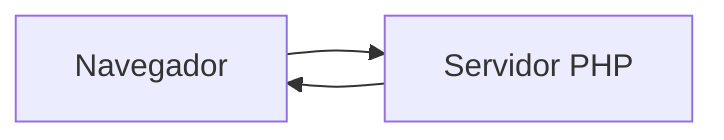

# Práctica 2 de PHP


Seis ejercicios para practicar *PHP*. Este documento también es un **ejemplo de Markdown**.


> Programar es ~~memorizar~~ practicar.

## Ejercicios

| Nº  | Archivo            | Qué hace                       |
| :-: | :----------------- | :----------------------------- |
| 1   | `temperaturas.php` | Convierte grados Celsius       |
| 2   | `factorial.php`    | Calcula el factorial           |
| 3   | `vocales.php`      | Cuenta las vocales de un texto |
| 4   | `aleatorios.php`   | Genera 10 números aleatorios   |
| 5   | `cumpleanos.php`   | Días hasta cada cumpleaños     |
| 6   | `operaciones.php`  | Calculadora de dos números     |

Los cambios están en el [CHANGELOG](CHANGELOG.md)[^1].

## Cómo ejecutarlo

Necesitas:

- PHP 8.2
- Un navegador
  - Chrome o Firefox

```bash
php -S localhost:8000
```

> [!NOTE]
> Los ejercicios se abren con el servidor, no desde la carpeta.

Ojo con el último:

> [!WARNING]
> El ejercicio 6 se abre desde `operaciones.html`.

## Cómo funciona



## Tareas pendientes

- [x] Hacer los 6 ejercicios
- [ ] Corregir la fórmula de Kelvin

## Preguntas frecuentes

<details>
<summary>¿Por qué cambian los números del ejercicio 4?</summary>

Porque `rand()` genera números nuevos cada vez.

</details>

## Licencia

Uso la licencia **MIT** (ver [LICENSE](LICENSE)) porque:

1. Es corta y fácil de entender.
2. Permite usar y modificar el código.

Para colaborar, lee [CONTRIBUTING](CONTRIBUTING.md).

## Autoría

Rubén Ruiz Ortiz - 2º DAW - IES Alixar

[^1]: Seguimos el formato Keep a Changelog.
